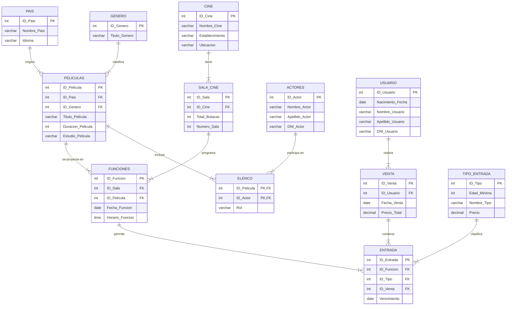

# Sistema-Gestor-Del-Proyecto-Cine

## Modelo relacional

### Relaciones principales

- Una película puede participar en varias funciones, y una función pertenece a una película.
- Una película puede tener varios actores y un actor puede participar en varias películas mediante `Elenco`.
- Un cine tiene varias salas y una sala puede tener varias funciones.
- Un usuario puede realizar varias ventas y una venta puede contener varias entradas.
- Cada entrada pertenece a una función y tiene un tipo de entrada.